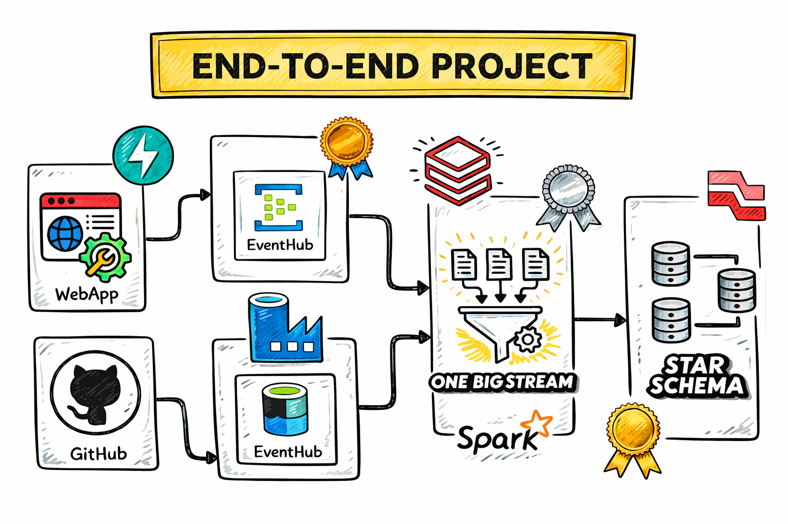
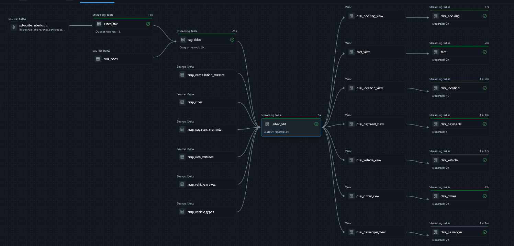

# Real-Time Uber Medallion Lakehouse Engineering


An enterprise-grade, end-to-end real-time data engineering platform simulating an on-demand ride-hailing system (Uber). The pipeline captures client-side ride dispatch events in real time, unifies them with static reference metadata and historical backfills, dynamically compiles SQL transformations using Jinja2, and materializes a production Star Schema with Auto-CDC Slowly Changing Dimensions (SCD 1 & 2) in Databricks Unity Catalog.

---

## Architecture Blueprint



### End-to-End Pipeline Execution DAG (Databricks Lakeflow)



---

## Executive Summary & Engineering Challenges

High-concurrency mobility platforms process millions of transaction events every minute—dispatches, real-time GPS telemetry, surge calculations, and fare reconciliations. Operating teams need sub-minute analytical visibility without compromising data consistency or blowing cloud compute budgets.

### Core Problems Solved:

* **Unifying Streaming Events with Massive Historical Backfills:**
  * Ingesting live firehose transactions while reconciling 2,000+ historical batch records (`bulk_rides`) often introduces duplicate records or requires expensive repeated full-table overwrites.
  * *Solution:* Leveraged Databricks Spark Declarative Pipelines (SDP / Lakeflow) with `@dp.append_flow`. The historical backfill runs once (`once=True`), while streaming transactions append continuously (`once=False`), ensuring strictly idempotent, exactly-once processing.

* **Eliminating Pipeline Maintenance Debt via Metadata-Driven Ingestion:**
  * Hardcoding schemas for 7+ reference dimension lookups across pipelines creates brittle code that breaks whenever upstream schema attributes change.
  * *Solution:* Developed two levels of dynamic automation:
    * **Azure Data Factory:** A single parameterized pipeline iterates over a dynamic configuration array (`files_array.json`), automating HTTP-to-ADLS Gen2 copy activities without manual pipeline duplication.
    * **Jinja2 SQL Compilation Engine:** Dynamically generates complex multi-table joins for the Silver One Big Table (OBT) from a Python configuration dictionary, reducing schema evolution maintenance to zero-code configuration edits.

* **Bounding State Memory on Real-Time Joins:**
  * Joining continuous transaction streams with static dimensions can cause memory state explosion if late-arriving events are not bounded.
  * *Solution:* Applied an explicit 3-minute watermark (`WATERMARK booking_timestamp DELAY OF INTERVAL 3 MINUTES`) to drop stale states outside the processing window, safeguarding cluster stability.

* **Tracking Historical Attribute Drift (SCD Type 2):**
  * Reference dimensions (e.g., city territory reallocations) change over time. Overwriting values corrupts historical reporting, while standard tracking requires hundreds of lines of complex merge scripts.
  * *Solution:* Implemented `dp.create_auto_cdc_flow` to automatically manage `__START_AT` and `__END_AT` audit intervals on `Dim_location`, while enforcing strict active-record filters (`__END_AT IS NULL`) on fact table joins to prevent Cartesian fan-out.

---

## Medallion Architecture Breakdown

```text
[ FastAPI Booking App ] ───> [ Azure Event Hubs (Kafka) ] ───> [ uber.bronze.rides_raw ]
                                                                        │
[ GitHub / HTTP Lookups ] ──> [ Azure Data Factory ] ───────> [ uber.bronze.map_* ]
                                                                        │
                                                                        ▼
                                                          [ uber.bronze.stg_rides ]
                                                          (Append Flow: Bulk + Stream)
                                                                        │
                                                              (3-Min Watermark Join)
                                                              (Jinja2 OBT Engine)
                                                                        ▼
                                                          [ uber.silver.silver_obt ]
                                                                        │
                                                               (dp.create_auto_cdc)
                                                                        ▼
                                                      ═════════════════════════════════
                                                          GOLD LAYER (Star Schema)
                                                      ═════════════════════════════════
                                                      • uber.gold.fact (Central Fact)
                                                      • uber.gold.Dim_location (SCD 2)
                                                      • uber.gold.Dim_passenger (SCD 1)
                                                      • uber.gold.Dim_driver (SCD 1)
                                                      • uber.gold.Dim_vehicle (SCD 1)
                                                      • uber.gold.Dim_payments (SCD 1)
                                                      • uber.gold.Dim_booking (SCD 1)
```

---

## Detailed Pipeline Implementation

### 1. The Producer: Live Simulation App (`App/`)
* **Local Web Interface:** Built a FastAPI web application (`App/api.py`) backed by HTML templates (`App/app_design/`) allowing interactive ride booking from any browser.
* **Telemetry Generator (`App/data.py`):** Programmatically constructs real-time JSON payloads containing ride IDs, confirmation numbers, dynamic GPS coordinates, driver metadata, surge multipliers, fares, and timestamps.
* **Event Hubs Kafka Producer (`App/connection.py`):** Transmits payloads asynchronously over SASL/SSL directly into Azure Event Hubs (`ubertopic`) with full Kafka protocol compatibility.

### 2. Bronze Layer: Raw Ingestion & Staging (`Databricks/.../bronze/`)
* **`uber.bronze.rides_raw`:** Reads Kafka streams via `spark.readStream.format("kafka")`, converting raw binary payloads into JSON strings for auditing and replayability.
* **`uber.bronze.bulk_rides` & Lookup Tables:** Batch loads 2,000+ historical rides along with 6 static lookup tables (`map_cities`, `map_vehicle_types`, `map_vehicle_makes`, `map_payment_methods`, `map_ride_statuses`, `map_cancellation_reasons`) into Delta format.
* **`uber.bronze.stg_rides`:** Combines historical batch records with parsed, schema-validated streaming transactions using `@dp.append_flow`.

### 3. Silver Layer: Dynamic OBT & Stateful Streaming Joins (`Databricks/.../silver/`)
* **Jinja2 SQL Templating Engine:** Automatically constructs the multi-table join SQL. Instead of hardcoded statements, dimension additions are maintained in a configuration dictionary:

```python
{
    "table": "uber.bronze.map_vehicle_types",
    "select": "map_vehicle_types.vehicle_type, map_vehicle_types.base_rate, map_vehicle_types.per_mile",
    "on": "stg_rides.vehicle_type_id = map_vehicle_types.vehicle_type_id"
}
```

* **Watermarked Stream-Static Join (`Silver_OBT.sql`):** Combines the live transaction stream with all reference tables to produce the consolidated One Big Table (`uber.silver.silver_obt`):

```sql
CREATE OR REFRESH STREAMING TABLE uber.silver.silver_obt AS
SELECT 
    stg_rides.*,
    map_cities.city AS pickup_city,
    map_cities.state,
    map_cities.region,
    map_cities.updated_at AS city_updated_at,
    map_vehicle_makes.vehicle_make,
    map_vehicle_types.vehicle_type,
    map_payment_methods.payment_method
FROM stream(uber.bronze.stg_rides)
WATERMARK booking_timestamp DELAY OF INTERVAL 3 MINUTES stg_rides
LEFT JOIN uber.bronze.map_cities 
    ON stg_rides.pickup_city_id = map_cities.city_id
LEFT JOIN uber.bronze.map_vehicle_types 
    ON stg_rides.vehicle_type_id = map_vehicle_types.vehicle_type_id
```

### 4. Gold Layer: Star Schema & Automated CDC (`Databricks/.../gold/model.py`)
Materializes a normalized Dimensional Model partitioned into 6 dimensions and a central Fact table:

| Table | Modeling Strategy | Primary Key | Sequencing Column | Purpose |
| :--- | :--- | :--- | :--- | :--- |
| `Dim_passenger` | SCD Type 1 | `passenger_id` | `passenger_id` | Passenger profiles and contact information |
| `Dim_driver` | SCD Type 1 | `driver_id` | `driver_id` | Driver credentials, ratings, and licensing |
| `Dim_vehicle` | SCD Type 1 | `vehicle_id` | `vehicle_id` | Vehicle specifications, models, and classes |
| `Dim_payments` | SCD Type 1 | `payment_method_id` | `payment_method_id` | Payment gateway configurations and auth flags |
| `Dim_booking` | SCD Type 1 | `ride_id` | `ride_id` | Master booking context and routing endpoints |
| `Dim_location` | SCD Type 2 | `pickup_city_id` | `city_updated_at` | Tracks municipal boundary and regional updates |
| `fact` | Transaction Fact | Composite Keys | `ride_id` | Core numeric metrics (fares, distance, tip, surge) |

---

## Analytical Verification Queries

### 1. Active Dimensional Star Schema Query
```sql
SELECT 
    f.ride_id,
    p.passenger_name,
    d.driver_name,
    v.vehicle_model,
    loc.pickup_city,
    f.distance_miles,
    f.duration_minutes,
    f.surge_multiplier,
    f.total_fare
FROM uber.gold.fact f
LEFT JOIN uber.gold.Dim_passenger p 
    ON f.passenger_id = p.passenger_id
LEFT JOIN uber.gold.Dim_driver d 
    ON f.driver_id = d.driver_id
LEFT JOIN uber.gold.Dim_vehicle v 
    ON f.vehicle_id = v.vehicle_id
LEFT JOIN uber.gold.Dim_location loc 
    ON f.pickup_city_id = loc.pickup_city_id 
    AND loc.__END_AT IS NULL   -- Guardrail: Filters out expired historical records
LIMIT 10;
```

### 2. Auditing SCD Type 2 Historical Changes
```sql
SELECT 
    pickup_city_id,
    pickup_city,
    city_updated_at,
    __START_AT,
    __END_AT
FROM uber.gold.Dim_location
WHERE pickup_city_id = 2
ORDER BY __START_AT ASC;
```

---

## Repository Structure

```text
├── App/
│   ├── api.py                     # FastAPI web application for interactive booking
│   ├── connection.py              # Event Hubs asynchronous client producer
│   ├── data.py                    # Synthetic ride telemetry and JSON payload generator
│   └── app_design/                # HTML/CSS UI templates for ride booking
├── Databricks/
│   └── uber_rides_ingest/
│       ├── transformations/
│       │   ├── bronze/
│       │   │   ├── ingest.py      # Kafka streaming ingestion into bronze
│       │   │   └── bronze_adls.ipynb # ADLS Gen2 batch ingestion
│       │   ├── silver/
│       │   │   ├── silver.py      # Unified staging append flow (bulk + stream)
│       │   │   └── Silver_OBT.sql # Silver OBT with 3-minute watermark join
│       │   └── gold/
│       │       └── model.py       # Star Schema Fact & Dimensions via Auto-CDC
│       ├── explorations/          # Prototyping and stream verification notebooks
│       └── jinja_for_OBT.ipynb    # Jinja2 metadata-driven SQL generation engine
├── Mapping_tables/                # Source lookup JSON files (cities, makes, types, bulk)
├── Images/
│   ├── architecture.png           # End-to-end cloud architecture diagram
│   └── Pipeline_Graph.png         # Databricks Lakeflow execution DAG
├── config/
│   ├── files_array.json           # ADF parameterization configuration
│   ├── requirements.txt           # Python library dependencies
│   ├── pyproject.toml             # Project build configuration
│   └── .python-version            # Python runtime version
└── README.md
```

---

## Local Setup & Quickstart

### 1. Prerequisites
* Azure Account (Event Hubs Standard namespace, Data Factory, ADLS Gen2).
* Databricks Workspace (Serverless or Classic compute enabled with Unity Catalog).
* Local Python 3.10+ runtime.

### 2. Local App Simulation
```bash
# Clone the repository
git clone [https://github.com/botchoridzetemuri/Uber-Data-Engineering-Project.git](https://github.com/botchoridzetemuri/Uber-Data-Engineering-Project.git)
cd Uber-Data-Engineering-Project

# Set up virtual environment
python -m venv .venv
source .venv/bin/activate    # On Windows: .venv\Scripts\Activate.ps1
pip install -r config/requirements.txt

# Run the FastAPI Booking Application
uvicorn App.api:app --reload --port 8000
```

Open `http://localhost:8000` in your browser. Every time you click **"Book a Ride"**, a new transaction is generated and published to your Azure Event Hub topic in real time.

---

## Tech Stack Summary

* **Event Broker:** Azure Event Hubs (Standard Tier, Kafka Protocol)
* **Storage Layer:** Azure Data Lake Storage Gen2 (Hierarchical Namespace) & Delta Lake
* **Orchestration:** Azure Data Factory (Dynamic Parameterized Pipelines) & Databricks Workflows
* **Transformation & Processing:** Apache Spark 3.5+, PySpark Structured Streaming, Spark Declarative Pipelines (Lakeflow / DLT)
* **Data Modeling & Governance:** Databricks Unity Catalog, Jinja2 Templating, Auto-CDC (SCD 1 & 2)
* **Producer Simulation:** Python, FastAPI, Uvicorn, Jinja2
    ON stg_rides.pickup_city_id = map_cities.city_id 
LEFT JOIN uber.bronze.map_vehicle_types 
    ON stg_rides.vehicle_type_id = map_vehicle_types.vehicle_type_id

